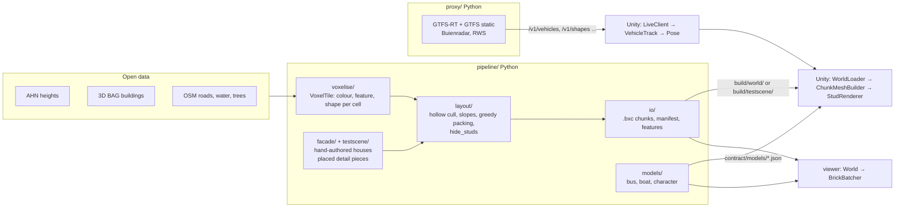

# Architecture

Maastricht Blox is a brick-built, live miniature of a 2 × 2 km slice of Maastricht. Four
programs share one written contract (`CONTRACT.md` + `contract/*.json`):

| Component | Language | Folder | Job |
|---|---|---|---|
| Pipeline | Python 3.11, numpy/numba | `pipeline/` | open data → voxel grid → bricks → chunk files; also writes brick models |
| Live proxy | Python, FastAPI | `proxy/` | polls buses, weather and the river level, serves them in Unity metres |
| Game | C# (Unity 6 URP) | `unity/Assets/Blox/` | streams chunks, meshes them, renders, runs movers and gameplay |
| Viewer | JavaScript, three.js | `viewer/` | browser preview of the same chunks, for look development without Unity |
| C# test harness | .NET 8, xUnit | `dotnet/` | compiles the engine-free Unity code and tests it outside Unity |

## Data flow



In words:

1. **Sources → voxel grid.** `blox fetch` downloads AHN, 3D BAG and OSM. `blox build`
   rasterises them per chunk into a dense `VoxelTile`: per cell a palette colour, a feature
   id and a shape code (full, slope, ridge, tile, water). See CONTRACT 7 and
   [guide 02](guide/02-pipeline.md).
2. **Hand-authored detail.** The facade grammar (`pipeline/src/blox_pipeline/facade/`)
   paints townhouses into a tile and *places* detail pieces (windows, doors, arches,
   fences) next to the voxels. Today only the look-test scene uses it.
3. **Voxel grid → brick layout.** `layout_tile` keeps only visible cells, turns slope stacks
   into slope bricks, packs the rest into the biggest bricks/plates/tiles that fit, adds the
   placed pieces unchanged and sets `hide_studs`.
4. **Bricks → chunks.** `write_world` writes one `.bxc` per non-empty 64 × 64-stud chunk
   plus `manifest.json`, `features.json` and copies of palette and catalogue.
5. **Chunks → renderers.** Unity and the viewer both read the same files. Each derives
   geometry from the catalogue and the record's rotation; neither stores meshes.
6. **Live movers.** The proxy turns live bus positions into Unity metres plus a distance
   along a route shape. Unity turns that into a `Pose` with the shared `PathMover` and
   places a brick model there. See [guide 05](guide/05-movers-and-models.md).

## Design decisions and why

| Decision | Why | Where |
|---|---|---|
| **Contract first** | Pipeline, proxy, Unity and viewer were built in parallel by different agents. They code against `CONTRACT.md`, not against each other. Changing it means bumping `contractVersion` and updating every component (v1 → v2 on 2026-10-19). | `CONTRACT.md`, `contract/` |
| **Scale: 0.5 m studs, 0.2 m plates** | Real brick proportions (8 : 3.2 : 9.6) at a size where 2 × 2 km is 4096 × 4096 studs, small enough for one PC. Small details (window frames, mullions) come from custom pieces, not a finer grid (see DEVLOG, "option 2"). | CONTRACT 1 |
| **Column chunks of 64 × 64 studs** | 32 m squares, full height. A chunk is the unit of loading, meshing and LOD. Bricks never cross chunk borders, so each chunk meshes on its own. | CONTRACT 1, 4 |
| **Palette indices, not colours** | Data is quantised to a curated palette. That keeps the "toy" look consistent and lets the shader pick a material class (`solid`, `glass`, ...) per index. | `contract/palette.json` |
| **Hollow bricks** | Only bricks with a face exposed to air (or glass/water) are stored. Building interiors and deep ground are dropped, which cuts brick counts a lot. | `layout/cull.py` |
| **`hide_studs` flag** | Because interiors are dropped, a renderer cannot tell that a floor's studs sit under a solid (but unstored) wall. The pipeline knows, so it sets rotFlags bit 3 and renderers skip those studs. | `layout/studs.py` |
| **Compact binary chunks** | 12 bytes per brick, raw DEFLATE body. Simple enough to read in Python, C# and JS with no library beyond inflate. | [guide 03](guide/03-chunk-format.md) |
| **Variation from a hash** | Per-brick colour jitter isn't stored. Every renderer hashes the global position, so the files stay small and the result is stable. | `Data/Geometry/BrickVariation.cs`, `viewer/src/hash.js` |
| **Instanced studs (Unity)** | Studs are most of the triangles. The mesher emits a stud list per chunk, and the GPU culls and draws them with two indirect calls (near, mid). Far away the brick shader fakes them. | `Rendering/StudRenderer.cs`, `Shaders/StudCull.compute` |
| **Analytic bevels in Unity, real bevels in the viewer** | Unity: one flat polygon per brick face. The mesher writes face-local position and face size into UVs, and the shader bends the normal near edges and draws the seam. That gives bevels for zero extra triangles, which matters for a whole city. Viewer: one chunk only, so it uses real rounded-box geometry (`RoundedBoxGeometry`). That's simpler, and fine at that size. | `Shaders/Include/BloxEdges.hlsl`, `viewer/src/shapes.js` |
| **The facing rule** | Rotation bugs are the classic failure. One rule everywhere: every directional piece's front faces +j at rot 0, and code says N/E/S/W instead of computing `rot`. Each language has one rotation module that passes the same test vectors. | [guide 01](guide/01-coordinates-and-rotation.md) |
| **Detail pieces are placed, not inferred** | A window frame has no voxel shape. The facade grammar places catalogue pieces directly; layout passes them through. Their cells are air in the grid, so the wall behind keeps its faces. | `layout/placed.py` |
| **Brick models for moving things** | Buses, boats and people are small brick assemblies in JSON, built from the same catalogue. Both renderers reuse their brick geometry for them, and animated parts swing about pivots. | `contract/models/`, CONTRACT 7.1 |
| **One pose type, one `PathMover`** | Live buses, scripted followers and the walking character all produce `Pose{position, yaw}`, so one "apply pose" step places anything. | `Data/Motion/`, `viewer/src/mover.js` |
| **Engine-free C# core** | `Blox.Data`, `Meshing/Core`, `Live` (except the HTTP client) and `Gameplay/Core` have no UnityEngine reference. The dotnet harness tests them without Unity being installed. | `dotnet/`, `Editor/PureTests~/` |
| **No hand-edited Unity YAML** | Scenes, URP assets and materials are made by editor menu scripts, so they are reviewable code and can be rebuilt. | `unity/Assets/Blox/Editor/` |
| **Viewer as a second renderer** | Unity can't run in the build container. The viewer renders the same chunks in headless Chromium for screenshots, and catches data and rotation bugs a second time. | `viewer/` |
| **Proxy does the projection** | Unity never does map projection. The proxy sends Unity metres (and WGS84) and keeps the upstream polling polite. | `proxy/src/blox_proxy/geo.py` |

## Assembly dependencies (Unity)

References, read "A → B" as "A uses B" (from the `.asmdef` files):

```
Blox.Live      → Blox.Data
Blox.Meshing   → Blox.Data, Burst, Collections, Mathematics
Blox.Rendering → Blox.Data, Blox.Meshing, URP
Blox.Gameplay  → Blox.Data, Blox.Meshing, Input System, URP     (never Blox.Rendering)
Blox.Editor    → Blox.Data, Blox.Rendering, Blox.Gameplay, URP
Blox.Data      → nothing (pure C#: formats, Rotation, Pose, PathMover, BrickModel, WorldIndex)
```

Data and Gameplay never reference Rendering (CLAUDE.md rule). Gameplay gets the loaded world
through the `Blox.Data.IWorldSource` interface, which Rendering's `WorldLoader` implements.
